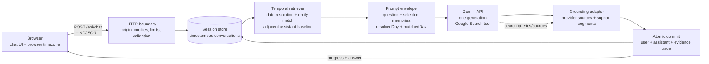

# Architecture

Recall is a small, dependency-free Node.js service. Its core idea: separate **what was said before** from **what is true now**, then make both inspectable.



## Request lifecycle

```mermaid
sequenceDiagram
    participant B as Browser
    participant H as HTTP boundary
    participant M as Memory retriever
    participant G as Gemini + Google Search
    participant S as Session store

    B->>H: POST /api/chat
    H->>H: Validate origin, cookie, JSON, timezone, limits
    H->>M: Retrieve dated evidence
    M->>S: Read timestamped conversations
    M-->>H: Selected memories + resolvedDay + matchedDay
    H->>G: One generation; Search available
    G-->>H: Answer + grounding metadata
    H->>H: Insert only supported citations
    H->>S: Atomically save user + assistant pair
    H-->>B: progress, then answer event
```

## Components

| Component | Responsibility | Why it is separate |
|---|---|---|
| `public/` | Chat UI, conversation navigation, safe rendering, export/delete | Keeps browser concerns out of server logic |
| `src/server.js` | HTTP boundary, sessions, limits, request lifecycle, NDJSON | Single place for transport and security policy |
| `src/memory.js` | Timezone-aware dates, entity matching, bounded retrieval | Deterministic and testable without a model |
| `src/agent.js` | Retrieval → generation → persistence orchestration | Makes the turn pipeline explicit |
| `src/gemini.js` | Gemini REST adapter and retry policy | Isolates provider details |
| `src/grounding.js` | Source normalization and citation insertion | Prevents fabricated citation URLs/IDs |
| `src/store.js` | Serialized atomic persistence | Isolates storage; replaceable boundary |
| `src/config.js` | Server-only configuration | Keeps secrets out of browser code |

## Data flow

1. The browser sends the message, conversation ID, and its IANA timezone.
2. The server validates the request and checks that the conversation belongs to the session cookie.
3. The retriever selects dated user messages, nearby assistant answers, lexical matches, and recent context across that session.
4. The retriever resolves calendar references such as “last Tuesday” using the browser timezone; UTC remains the canonical storage timestamp.
5. Gemini receives the current question and selected historical evidence, with Google Search as its only external tool.
6. The grounding adapter converts provider metadata into source links and citation labels.
7. After a successful response, the user and assistant messages are committed together with the evidence trace.
8. The browser renders plain text safely and displays sources, evidence trail, and the sandboxed search-suggestions widget when supplied.

## Memory model

```text
Session (browser cookie)
└── Conversations
    ├── User message: timestamp, text
    └── Assistant message: timestamp, text, sources, audit
```

Retrieval is deliberately deterministic:

- Date phrases are resolved before model generation.
- Lexical entity matching finds prior user turns.
- Adjacent assistant messages preserve the original baseline.
- Recent messages preserve pronoun-only follow-ups.
- A character budget prevents unbounded context growth.
- Missing dated history is surfaced as `matchedDay: false`, not invented.

## Security boundaries

- The API key is server-side only; it is never sent to the browser or included in prompts/history/logs.
- Session cookies are `HttpOnly` and `SameSite=Strict`; `Secure` is enabled behind HTTPS.
- Conversation IDs are not authorization: every read/write is scoped to the session cookie.
- Browser and model content are rendered as text nodes, never raw HTML.
- Search-provider markup is placed in a script-disabled sandboxed iframe.
- The server allows only an exact configured write origin and a fixed public asset allowlist.

## Honest limits

- This is a single-process JSON store, not a distributed database; it is not multi-instance safe.
- Atomic rename protects against partial replacement but does not provide power-loss durability guarantees.
- Retrieval is lexical and date-based, not semantic search.
- Search grounding is model-managed; the adapter cannot force a search.
- Citation support is evidence of provider attribution, not independent fact-checking.
- Rate limits are local and in-memory; a public deployment needs edge/global quotas.
- No account system, cross-device sync, retention automation, or automated backup is included.

## What another week buys

- A dated-history evaluation set with claim-level human review.
- A clarifying retrieval pass only where measured failures justify extra latency.
- Authenticated users and a transactional database.
- Managed secrets, HTTPS, global quotas, retention, backups, and observability.
- Better multi-reference retrieval, semantic recall, cancellation/idempotency, and truncation handling.
- Live verification of Search-suggestion rendering and browser behavior.
